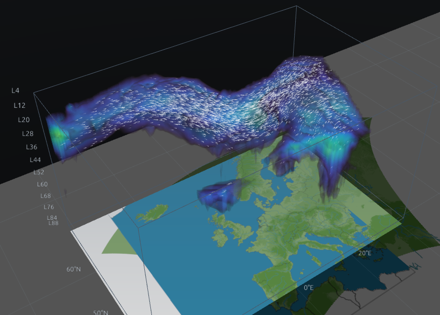

# EDR 3D Viewer

Single-page WebGL (three.js) viewer for OGC API – EDR `cube` queries returning CoverageJSON.

**Live:** https://maartenplieger.github.io/3d-edr-viewer/ · **Source:** https://github.com/maartenplieger/3d-edr-viewer



Controls on the left, 3D view on the right. Isosurfaces are computed in the browser with
marching cubes; slices are coloured with a colour map and contour lines.

Built with [Vite](https://vite.dev) (Node.js 20.19 or newer):

```sh
npm install
npm run dev       # development server with live reload: http://localhost:8765
npm run build     # single-page app in dist/
npm run preview   # serve dist/ at http://localhost:8765 to check the build
```

`dist/` is a static single-page app with relative paths: copy it to any web server, at any path. Every push to
`main` builds it and publishes it on GitHub Pages (`.github/workflows/deploy.yml`; the repository needs
*Settings → Pages → Source: GitHub Actions*). three.js and
topojson-client come from npm (`package.json`); the coastline/border data and the base maps are fetched at
run time.

On startup it applies the first preset, *Jet stream – DINI (uwcw-ha-det-dini-5p5km, geoservices)*: KNMI
UWCW HARMONIE model-level wind speed for the latest run over the full model domain on its native rotated pole
grid (every 4th level from level 4, 4×4 averaged), as a volume filled above 50 kt with vertical scale ×10. To
use other data, enter an EDR
endpoint (e.g. `https://geoservices.knmi.nl/edr`) or a collection URL (`…/edr/collections/{id}`) at the top of
the **Data** panel and press Enter or *Open*. An endpoint lists all its collections with at least two levels
(and a cube query) under *Collection*, and opens the first; pick another there. A complete cube URL can still
be pasted under *Paste a cube URL* at the bottom of the panel.

## Notes

- **View bar.** The controls at the top of the view (parameter, time, threshold, density, how it is shown,
  vertical scale, streamlines, fly around) are compact, with their labels beside them; ▴ at its right end
  collapses it to a small *▾ View* button (remembered in this browser). The animation controls are on the time
  line at the bottom.
- **Panel.** « at the top of the panel hides it, so the 3D view gets the whole window; ☰ in the view bar
  brings it back. The choice is remembered in the browser.
- **Grid cells.** *Appearance → Grid cells* draws the cells in use: their edges on the ground, and on the
  west and north walls a line per column and per loaded level (following the actual heights in pressure
  altitude mode). With a horizontal step these are the averaged cells, on a native grid the native cells.
- **Sun and moon.** *Appearance → Sun and moon at the shown time* puts the sun where it is at the shown time, seen from the centre
  of the data (on a rotated grid turned to grid north), from the Astronomical Almanac's low-precision formulas.
  The light on isosurfaces and the volume then comes from the sun, the sky turns blue by day with a glow around
  the sun and twilight colours when it is low, and the stars fade out. The moon (about 0.3° accurate, shown
  2.5× its real size) is lit from the sun's direction, so its phase is right. The HUD gives the sun's elevation
  and azimuth and the moon's elevation and illuminated fraction; both follow the time, also while animating.
- **Stars.** The sky has the 1630 stars of the Yale Bright Star Catalogue up to magnitude 5, where they are at the
  shown time, with their brightness and colour. *Appearance → Star names* labels the 55 best-known ones.
- **Globe.** *Appearance → Globe* wraps the scene around the Earth: every point goes to its real lon/lat on a
  sphere with the Earth's radius, at its height (times the vertical scale). The centre of the data stays on top,
  so the view starts like the flat one, only curved; zoom out to see the whole Earth. Slices, isosurfaces (with
  their normals), streamlines, borders, grid cells, labels and the box are placed on the globe; the volume's
  ray marching turns every sample back to the flat data. With *Earth surface* the whole globe gets a world base
  map (the selected layer stays on the data area), with the night side darker when the sun is on. Far above the
  Earth the sky fades to black space with stars all around. Changing the vertical scale rebuilds the geometry.
  The volume is ray marched only where the ray is inside the shell of the data around the Earth (from its top to
  the ground), with the opacity measured in the data's own space, so even data covering the whole Earth (a thin
  shell in a big box) is sampled finely and looks as in the flat view. The steps adapt to about one texel of the
  data each (fine where the ray crosses levels or cells quickly, long where it runs along them); *Quality* sets
  the finest step allowed. The Earth's axis is drawn through the
  poles, with N and S. When the data covers a large part of the Earth (150° of longitude or 100° of latitude),
  the view is centred on the Earth itself with north up: the mouse orbits about the Earth's axis, *Fly around*
  spins around it near the equator, labels stay a readable size and the box is left out. The map under the data
  uses the selected base layer when that covers most of the data, otherwise the world layer.
- **Vector base map.** *Appearance → Base map → Land and sea (vector, Natural Earth)* draws land, sea, coastlines
  and country borders from the Natural Earth 1:10M vectors of the border file (`src/vectormap.js`) into a canvas
  in the grid's own coordinates (also a rotated pole grid), instead of a WMS image: no map server needed, the
  same style for the whole world, flat or on the globe. The global ECMWF preset uses it. It is drawn in a web worker
  (`src/vectorworker.js`) on a CPU canvas: drawing thousands of polygons takes seconds, and an accelerated canvas
  would be drawn in the browser's GPU process, which the WebGL view shares; the view stays responsive while the
  map is drawn (a few seconds the first time).
- **Wind with streamlines.** When a collection has both wind speed and wind direction
  (`wind_speed…` and `wind_from_direction…`), the parameter list ends with *Wind: speed + direction, with
  streamlines*. It loads both: the speed is drawn as usual, and 4000 particles with fading trails move with the
  wind on their model level (*Streamlines* in the view bar switches them off). The fastest wind crosses the area
  in about 12 s, so the speed is shown relatively, not in real time. Particles start where the volume is drawn:
  with *fill above* only above the threshold, so they trace e.g. the jet stream. The direction (where the wind
  comes from, clockwise from true north) is turned to grid north per column on a rotated pole grid. With a
  horizontal step directions are averaged as unit vectors, so 350° and 10° give 0°, not 180°. Hovering shows the
  direction too.
- **Kinds of levels.** EDR gives no usable vertical CRS here (`customvrs`), so the kind is told from the
  collection and parameter names: `…pl` are pressure levels (hPa), `…hagl` / `…height` heights above ground
  (m), anything else model levels (1 = top). Requests use the collection's own level values: a run of
  consecutive levels as a range (`z=200/850`), otherwise a list. *Level from/to* select a range of those values,
  and switch to all levels when a collection has other levels than the previous one. Pressure levels are drawn at
  their ISA height and heights at their height, with labels like `500 hPa` or `1000 m`; model levels are spaced
  evenly, or by their pressure in *Pressure altitude* mode.
- **Large grids.** To keep sliders smooth at full resolution: isosurfaces of grids above 500k points are
  computed in a web worker (`src/isoworker.js`), only for the newest slider value, while the previous surface
  stays visible; while only the volume is shown no isosurface is computed at all. The volume threshold and
  density are shader settings and follow the slider directly; streamline starting points follow once the slider
  settles. The view is only drawn when something changes, so an idle view costs almost nothing. If dragging the
  camera is still heavy, lower the volume *Quality* (ray-marching steps) or use a horizontal or vertical step.
- **Points read.** The HUD shows how many values were read from the server (grid × levels × parameters), how
  many of them had no data, and with a horizontal step how many points are shown after averaging.
- **View controls.** The bar at the top left of the 3D view has the parameter and the time (changing either
  loads it; ‹ › step to the previous or next time), the threshold (the first isosurface value, also the
  volume's fill threshold) with the volume density below it, how it is shown (volume filled above, below or in a band around the threshold, or
  an isosurface) and the vertical scale. They drive the same controls as the panel and stay in sync with it.
- **Animation.** ▶ on the time line at the bottom of the view steps through the times of the run and wraps around; ⏸ pauses, ⏹ stops
  at the first time of the loop. The loop-length menu (*all times*, or 6, 12, 24 or 48) limits the loop to that
  many times from the time shown when ▶ is pressed (shifted back when the run ends sooner); pausing and playing
  again keeps the loop, and the block bar dims the times outside it. The menu next to ▶ sets the time per
  frame, and *ahead* how many next times are loaded while one is shown (1–3, default 2:
  more keeps the server busy, which matters when every new time takes seconds). Every loaded cube stays in memory
  (up to 1 GB, oldest used dropped first), so a second loop, or going back to a time, needs no request. The
  *Load* button also uses the cached times. A manual load or time change stops the animation. The sun,
  moon and stars move smoothly while animating: their time runs on from the shown time to the next one during the
  frame (and waits there while the next time is still loading). *Appearance → In between* (default
  continuous, or every 5–30 minutes) also shows the data interpolated between two loaded times while animating,
  linearly (directions the shorter way round), so the motion is smoother without loading more data. When only
  the volume is shown, this is done on the graphics card: the next time goes into a second 3D texture once per
  step and every in-between frame only changes the blend, so it costs nothing on the main thread (continuous
  then means every drawn frame). With isosurfaces, slices or streamlines the values are interpolated on the
  CPU: continuous with isosurfaces means the next in-between frame as soon as the isosurface worker has finished
  the one before (as smooth as it can compute), otherwise every 5 minutes. Cubes are downloaded, parsed
  and averaged in two web workers (`src/cubeworker.js`), so loading the next times does not hold up the view.
- **Time line.** The bar at the bottom of the view has a block per time of the run: filled when in memory,
  partly filled while loading (by level requests done or bytes received), lightly filled when in the local
  cache, the shown time framed. Its playhead follows the shown moment, smoothly while animating, and its label
  gives that moment. Click or drag it to show any moment, also between two times (pauses the animation): blended
  on the graphics card when only the volume is shown, interpolated otherwise, following *In between* (off: the
  nearest time). Times not in memory yet are loaded when touched, most recently touched first and at
  most *ahead* at once; meanwhile the nearest time in memory is shown and the playhead already follows the
  pointer, and the moment appears when its times arrive. The HUD in the top right describes the loaded time and only changes when that changes, so it
  stays calm while animating.
- **Fly around.** *Fly around* in the view bar circles the camera slowly around the data (one turn in two
  minutes, rising and sinking a little), from a distance where all of it is in view. While the animation plays
  it moves with it, at the pace of the chosen frame time, and waits while a time is still loading and when the
  loop wraps; without an animation it circles on its own. Dragging and zooming still work while it circles;
  flying with the keys stops it.
- **Frame rate.** *Appearance → Frame rate* (on by default) shows in the bottom right of the view the frames
  drawn per second, the longest gap between two drawn frames (a stutter shows up there, orange above 50 ms) and
  the main-thread time per frame. The view is drawn on demand, so it says *idle* when nothing moves.
- **Background loading.** *Data → Load the other times in the background* (off after every page load) loads the other times
  of the run one at a time while not animating, forward from the shown time and then from the start, skipping
  those in memory or in the local cache, so they are there when you step, scrub or animate. It waits while
  animating (which loads ahead itself), scrubbing or loading, and while the tab is hidden; each time is loaded
  at most once per session.
- **Local cache.** *Data → Local cache* (default up to 2 GB) keeps the loaded times of a run in the browser
  (IndexedDB, `src/framestore.js`), decoded as the viewer uses them, so they are back in a fraction of a second,
  also after a reload or on another day; the least recently used are dropped beyond the limit. *Clear* removes
  them all, and the times in memory, so they are loaded from the server again (*Load* uses the caches). Only times of a run (an instance) are kept, as their data does not change. In the block bar they show
  as lightly filled blocks. Besides, the browser's own HTTP cache keeps geoservices responses for 10 hours.
- **Flying.** Fly through the scene with the keyboard, like a plane: <kbd>W</kbd>/<kbd>S</kbd> throttle (S slows
  down, and past zero flies backwards, up to the same top speed), <kbd>↑</kbd>/<kbd>↓</kbd> pitch the nose down and up, like a flight stick (hold <kbd>↓</kbd> for a loop, about 15 s),
  <kbd>←</kbd>/<kbd>→</kbd> roll, <kbd>A</kbd>/<kbd>D</kbd> rudder, <kbd>R</kbd> levels out (wings level, nose to
  the horizon, keeping the heading), <kbd>Space</kbd> stops and <kbd>Shift</kbd> gives 2× throttle and top speed.
  While flying the camera has its own attitude, so it can roll, fly upside down and loop. A banked plane turns by
  itself, more at speed, as in a coordinated turn; rotation rates build up and fade smoothly, and the speed is
  kept until you brake. The top speed is low (a fraction of the area per second), so it never goes fast. The
  bottom right shows the position (lon/lat), the height (model level, or km), the speed, the heading, and the
  pitch and bank (upside down when the bank is over 90°). On the globe, up is the local vertical. Using the mouse
  hands back to orbiting: the view levels and the orbit point moves to the data ahead. Keys are ignored while a
  panel field has the focus; click the view to fly again. *Appearance → Sky with horizon and stars* adds a
  reference while flying: a sky dome with the true horizon and stars, infinitely far away. *Earth surface around
  the data* continues the base map, as a reference for height and motion when flying low. The preset switches
  both on.
- **Presets.** The *Presets* section applies a complete view in one click; the first one is also the start
  view. Presets are defined in the `PRESETS` list in `src/main.js`.
  - *Jet stream – DINI (uwcw-ha-det-dini-5p5km, geoservices)*: KNMI UWCW HARMONIE DINI from
    `geoservices.knmi.nl`, on the model's native rotated pole grid (`crs=native`, no resampling to lon/lat),
    wind speed on the full model domain, every 4th model level from level 4 (8 levels per request), 4×4
    averaged, as a volume filled above 50 kt with vertical scale ×10, with the sky and the earth surface on.
  - *Jet stream core on the globe – DINI (geoservices)*: the same data on the globe, only the core of the jet
    stream (filled above 93.5 kt, density 0.83, vertical scale ×4.9), with the sun, moon, stars and star names,
    continuous in-between frames, seen from the south-east. Presets can set their own camera view
    (`view: { azimuth, elevation, distance }`), and switch the globe, sun and star names on or off.
  - *Jet streams – global (ECMWF IFS, meteocore)*: ECMWF IFS from FMI's meteocore, wind speed on all 14 pressure
    levels (1000–10 hPa), the whole Earth resampled by the server to 720×360 points (one level per request:
    meteocore counts two values per cell against its limit of a million), on the globe filled above 33 m/s,
    with the sun, moon, stars and star names, flying around the Earth's axis.
  - *Jet stream – Nordic (MEPS, meteocore)*: the MEPS forecast from FMI's meteocore
    (`https://meteocore.app.meteo.fi/edr`), wind speed on 13 pressure levels (1000–50 hPa) at their height,
    filled above 25 m/s (≈ 50 kt) with vertical scale ×15. The full domain at the native 2.5 km grid is over
    meteocore's limit of a million values per request, so the server resamples it to 300×300 points.
- **Server resolution.** *Server resolution* (e.g. `300x300`) asks the server to resample the data to that
  many points in x and y (EDR `resolution-x` / `resolution-y`), for servers that support it; empty uses the
  server's own grid. Unlike the horizontal step, which averages after downloading, this makes the requests
  smaller, which servers with a size limit need for large areas.
  On a native grid whose size the server gives in `crs_details` (adaguc-server), the *horizontal step* is
  asked from the server this way too: with step 4, `resolution-x/-y` for a quarter of the cells, so the server
  sends every 4th native cell instead of all of them, 16× less to send and parse. A server that ignores
  `resolution-x/-y` sends every cell, and the viewer averages them as before.

- **Native grid.** When a collection lists a rotated pole CRS in the cube's `crs_details` (adaguc-server
  with `crs=native`), the *Grid* selector offers it and uses it by default. The cube then comes back on the
  model's own grid, without resampling. The scene is built in rotated coordinates, where that grid is regular.
  Borders are rotated to match, the base map is requested from the WMS in the same `PROJ4:` CRS, and hover
  shows real lon/lat. The bbox fields stay lon/lat; as EDR requires, the request bbox is in the coordinates
  of `crs`, so it is converted to the rotated box that covers it, and the server returns the native cells
  inside that.
- **Requests.** Levels are fetched 5 per request (`z=10/14`, `z=15/19`, …), 6 requests in
  parallel. *Levels / request* = 1 gives one request per level; a large value fetches the
  whole cube in one request.
  *Vertical step* n loads only every n-th level from *Level from* (e.g. 1, 4, 7, … for 3), requested as a
  list (`z=1,4,7,10,13`); that means fewer requests and faster loading, at a coarser vertical resolution.
- **×10 server bug.** In a multi-level response the KNMI EDR server currently returns every
  level after the first one multiplied by 10 (whole numbers only). The *×10 fix* option
  (`auto`) detects this per response and divides those levels by 10.
- **Vertical coordinate.** *Model level index* spaces levels evenly, which stretches the
  boundary layer where the 10 °C surface lives. *Pressure altitude* also loads
  `air_pressure_ml` and places every grid point at its ISA altitude.
- **Isosurface / volume.** The threshold values can be drawn as marching-cubes isosurfaces,
  as a ray-marched volume (soft band around each value, or fill above/below the first value),
  or both.
- **Full model domain.** The *Full model domain* button sets the bbox to the collection's
  extent (≈ −42…39°E, 38…70°N, 676×564 points per level at the server's native spacing) and
  loads it. *Horizontal step* `auto` averages blocks of n×n points while loading so each level
  stays below ~100k points (2×2 for the full domain). Points outside the model domain come back as
  `-9999` and are treated as missing. *Netherlands* switches back to the default bbox.
- **Base map.** The bottom of the cube shows a GetMap image from the KNMI `baselayers` WMS
  (`https://geoservices.knmi.nl/wms?DATASET=baselayers`), requested in CRS:84 for the cube's
  bbox. Pick another layer or *None* under Appearance; vector borders are optional.
- **Depth haze.** Data further from the viewer fades slightly towards a blue-grey haze
  (Appearance → *Depth haze*, *Haze amount*). The fog range is fitted to the scene every frame,
  so the effect looks the same at any zoom level; the volume applies it per ray sample.
- Model level 1 is the model top (~14 hPa) and level 90 the lowest level near the surface.
- Hover over a slice or isosurface to read the value, position, model level and (if loaded)
  pressure.

## Files

- `src/edr.js` – EDR URL parsing/building, CoverageJSON → regular grid, scale fix
- `src/isosurface.js` – marching cubes on a grid with per-point heights (`src/mctables.js`: its lookup tables)
- `src/isoworker.js` – computes isosurfaces of large grids off the main thread
- `src/streamlines.js` – particles with trails moving with the derived wind
- `src/volume.js` – volume resampling, 3D texture and ray-marching shader
- `src/rotpole.js` – rotated pole CRS from WKT, rotated ↔ lon/lat
- `src/cubeworker.js` – loads cubes off the main thread
- `src/framestore.js` – the local cache of loaded cubes (IndexedDB)
- `src/vectormap.js` – land and sea drawn from Natural Earth vectors (the vector base map)
- `src/vectorworker.js` – draws the vector base map off the main thread
- `src/sun.js` – positions of the sun, the moon and the stars at a time
- `src/stars.js` – the stars up to magnitude 5 from the Yale Bright Star Catalogue (generated)
- `src/globe.js` – the globe projection: flat scene ↔ sphere
- `src/colormaps.js` – colour maps, shader texture and colour bar
- `src/main.js` – scene, UI wiring, slices, labels, picking
- `public/favicon.svg` – the icon: the ADAGUC globe seen from space, with a data cube and a jet stream
- `vite.config.js` – dev server and build settings

## Licence

Copyright 2026 Maarten Plieger. Licensed under the [Apache License, Version 2.0](LICENSE). See [NOTICE](NOTICE)
for the third-party parts: the marching cubes tables from three.js (MIT), and the bundled three.js (MIT) and
topojson-client (ISC).
